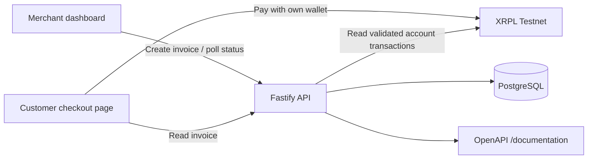

# Architecture

## System boundaries



## Components

- `apps/web`: React + Vite merchant console and public customer checkout page. It has no ledger keys and performs no signing.
- `apps/api`: Fastify API, OpenAPI surface, invoice domain module, PostgreSQL access, and XRPL payment monitor.
- `packages/contracts`: shared TypeBox request/response schemas and DTO types.
- PostgreSQL: durable invoice and payment records with unique destination-tag and transaction-hash constraints.
- XRPL SDK: official `xrpl.js` client configured only for the public Testnet endpoint in ledger mode.

## Payment lifecycle

```mermaid
sequenceDiagram
  participant M as Merchant
  participant W as Relay Pay web
  participant A as Fastify API
  participant DB as PostgreSQL
  participant C as Customer wallet
  participant L as XRPL Testnet
  M->>W: Enter XRP amount and reference
  W->>A: POST /v1/invoices
  A->>DB: Save pending invoice + unique tag
  A-->>W: Invoice ID, exact drops, tag, checkout URL
  W-->>M: Show QR and customer link
  C->>W: Open checkout page
  C->>L: Sign and submit Payment to merchant
  A->>L: Read validated merchant account transactions
  L-->>A: Validated Payment + tesSUCCESS metadata
  A->>DB: Match destination + tag + exact drops; mark paid
  W->>A: Poll invoice status
  A-->>W: Paid + transaction hash
```

## Invariants

1. Amounts are decimal strings at the API boundary and integer drops on ledger matching. JavaScript `number` arithmetic is never used to decide payment equality.
2. Destination tags are randomly allocated and protected by a database uniqueness constraint.
3. Only validated, successful native-XRP Payment transactions to the configured merchant address can confirm invoices.
4. A matching transaction must carry the invoice's tag and exact drops amount. Partial payments, overpayments, issued currencies, and failed transactions remain unpaid for manual handling.
5. The server observes payments; the customer wallet signs them. No wallet seed or secret is collected, stored, or logged.
6. Local simulation is isolated behind `PAYMENT_MODE=demo`; it is never available in XRPL Testnet mode.

## API surface

- `GET /healthz`: process liveness.
- `GET /readyz`: database and payment-ledger readiness.
- `GET /v1/config`: safe public mode/network/merchant configuration.
- `GET /v1/invoices`: latest 25 invoices.
- `POST /v1/invoices`: create a pending invoice.
- `GET /v1/invoices/{invoiceId}`: fetch current invoice state.
- `POST /v1/invoices/{invoiceId}/demo-payment`: local simulation only.
- `GET /documentation`: generated OpenAPI reference.
