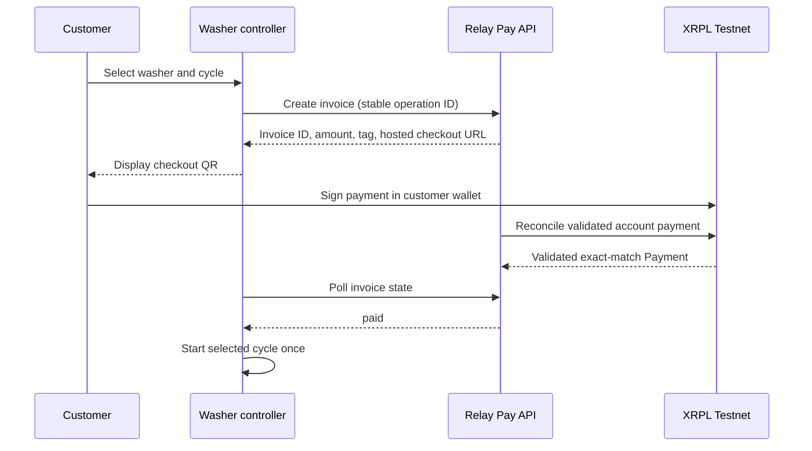

# Machine checkout: laundromat washer

## Goal

Let a customer pay for one washer cycle at an unattended laundromat. The washer starts only after Relay Pay reports that the exact native XRP payment has been validated on XRPL Testnet. The device never holds a wallet seed or signs a transaction.

## Actors and trust boundaries

- **Washer controller:** identifies the washer and selected cycle; it is not trusted to confirm payment.
- **Relay Pay API:** creates invoices, reconciles validated ledger payments, and reports invoice state.
- **Customer wallet:** prepares and signs a payment after the customer checks its destination, amount, network, and tag.
- **XRPL Testnet:** the final authority for whether a payment succeeded.

Device identity must be authenticated to the API. The machine credential is stored in the device's protected storage and never placed in a QR, checkout URL, or browser-visible customer payload. This remains a prototype design until MMP-012 selects and implements an auth model.

## Normal payment flow

1. Customer selects an available washer and cycle on the machine display.
2. The controller creates a request with a stable operation ID, merchant ID, device ID, machine ID, cycle code, and exact price.
3. API authenticates the device and creates one invoice for that operation. Retries with the same operation ID return the same invoice rather than creating a second charge.
4. Machine displays the hosted checkout QR and a short checkout reference. The API assigns a unique destination tag and exact XRP drops amount.
5. Customer scans the QR, confirms the Testnet network and payment fields in their wallet, and signs there.
6. Relay Pay keeps the invoice pending until the XRPL monitor finds a validated `tesSUCCESS` Payment with the exact merchant address, destination tag, and XRP amount.
7. Machine polls an authenticated device-status endpoint. It starts the cycle only after the API returns `paid` for the invoice attached to its active operation ID.
8. Machine records the invoice ID and cycle-start event locally, then reports the start result to the API for the merchant history.

## Connectivity and failure behavior

- **API unavailable before invoice creation:** do not display a payable QR and do not start the washer. Show “Payment service unavailable; please try again.”
- **Network lost after QR display:** keep the operation pending locally and continue showing the same checkout URL. Do not issue a replacement invoice during retries.
- **Payment made while the machine is offline:** the API may reconcile it when connectivity returns. The washer remains stopped until it successfully fetches `paid` for the active invoice.
- **Payment not seen before expiry:** keep the washer stopped. The customer must request staff support or start a new purchase after the old invoice expires.
- **Duplicate paid response or controller restart:** persist a one-time cycle-start marker keyed by invoice ID before sending the hardware start command. Never start a second cycle for the same invoice.
- **Uncertain hardware response:** report `start-unknown`, retain the invoice and operation IDs, and require device recovery/reconciliation; do not create a second charge automatically.
- **Wrong amount, destination, or tag:** invoice remains pending; support staff can investigate the transaction separately. The machine does not start.

## API and data requirements

These are follow-up implementation tickets, not claims about current behavior:

- Device authentication and merchant/device authorization.
- Idempotency key unique per merchant and device operation, persisted with the created invoice.
- Machine operation fields: merchant, device, machine, cycle, operation ID, invoice ID, expiry, and hardware state.
- Read-only device invoice-status endpoint with bounded polling, rate limiting, and a short response that excludes merchant secrets.
- Audit trail for request creation, payment validation, device acknowledgement, cycle start, expiry, and recovery.
- Explicit state machine: `created → awaiting_payment → paid → start_requested → started`, with `expired`, `cancelled`, and `start_unknown` recovery states.

## Prototype boundaries

- Testnet only; do not use real funds or attach physical equipment.
- No offline payment verification. A locally displayed receipt, wallet screenshot, or unvalidated transaction must never unlock a machine.
- One operation can start at most one cycle. Refunds, partial payments, multiple assets, and remote machine control are out of scope for this design.
- Before any public deployment, complete merchant/device authorization and security review.
